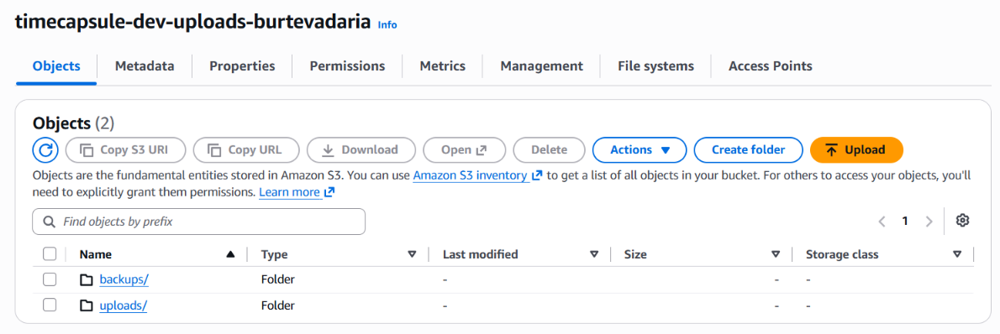
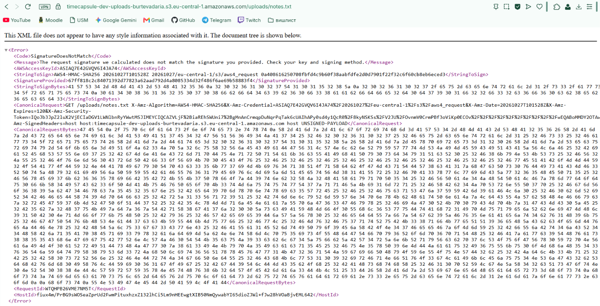
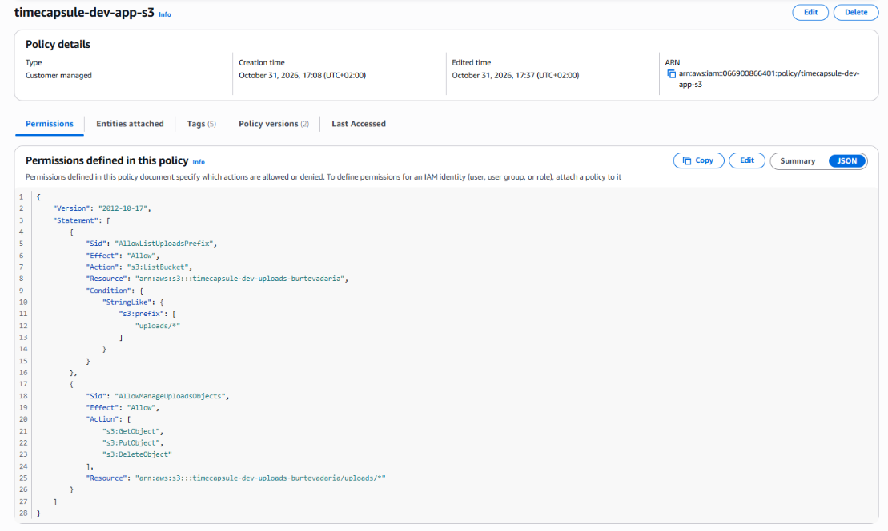

# Отчёт по лабораторной работе №4. Облачные хранилища. Amazon S3

**ФИО:** Дарья Бурцева  
**Группа:** IA2403  
**Специальность:** Informatică Aplicată  
**Выбранный уровень:** Продвинутый  
**Ссылка на репозиторий:** https://github.com/burtevadaria-cloud/lab4

---

## 1. Скриншоты базового уровня

### Задание 1. Бакет и объекты в консоли

Бакет `timecapsule-dev-uploads-burtevadaria` с папками `uploads/` и `backups/`, свойства загруженной картинки и ошибка `AccessDenied` при открытии прямого Object URL.

### Задание 2. Объекты из командной строки

Вывод трёх вариантов команды `aws s3 ls` и чтение метаданных объектов без скачивания с помощью `aws s3api head-object`.

### Задание 3. Политика бакета: только HTTPS

Политика бакета, запрещающая запросы без HTTPS, и вывод двух команд проверки в CloudShell.

### Задание 4. Версионирование и защита от удаления

Идентификаторы версий `null` у старых файлов, список версий `notes.txt` и состояние объекта после отката к версии `v1`.

### Задание 5. Правило жизненного цикла

Схема правила жизненного цикла `timecapsule-dev-noncurrent` для префикса `uploads/`.

### Задание 6. Подписанные URL

Ответы S3 на испорченную (`SignatureDoesNotMatch`) и просроченную (`Request has expired`) подписанные ссылки.

---

## 2. Скриншоты продвинутого уровня

### Задания 7–8. Политика приложения и проверка прав через тестовую роль

Документ политики приложения `timecapsule-dev-app-s3` и вывод `aws sts get-caller-identity` от имени тестовой роли `timecapsule-dev-s3-tester`.

| № | Команда | Ожидаю | Получил | Какое правило сработало |
| :--- | :--- | :--- | :--- | :--- |
| 1 | `aws s3 cp test.txt s3://$BUCKET/uploads/test.txt` | разрешено | разрешено | разрешение в политике приложения |
| 2 | `aws s3 ls s3://$BUCKET/uploads/` | разрешено | разрешено | разрешение в политике приложения |
| 3 | `aws s3 ls s3://$BUCKET` | AccessDenied | AccessDenied | неявный запрет |
| 4 | `aws s3 cp s3://$BUCKET/uploads/photo.txt -` | разрешено | разрешено | разрешение в политике приложения |
| 5 | `aws s3 ls s3://$BUCKET/backups/` | AccessDenied | AccessDenied | неявный запрет |
| 6 | `aws s3 cp test.txt s3://$BUCKET/backups/test.txt` | AccessDenied | AccessDenied | неявный запрет |
| 7 | `aws s3api list-object-versions --bucket $BUCKET --prefix uploads/` | AccessDenied | AccessDenied | неявный запрет |
| 8 | `aws s3api delete-object --bucket $BUCKET --key uploads/test.txt --version-id HosccC.6SJKcYYWofis4AzJU7tpoDTAH` | AccessDenied | AccessDenied | неявный запрет |
| 9 | `aws s3 rm s3://$BUCKET/uploads/test.txt` | разрешено | разрешено | разрешение в политике приложения |
| 10 | `aws s3 ls s3://$BUCKET/uploads/ --endpoint-url http://s3.eu-central-1.amazonaws.com` | AccessDenied | AccessDenied | явный запрет в политике бакета |

### Задание 9. Роль сервера

Вывод `aws sts get-caller-identity` и двух команд `aws s3 ls` на `app-server` от имени роли `timecapsule-dev-app-role`.

### Задание 10. Перенос существующих файлов

Вывод `aws s3 sync` при переносе вложений и пустой вывод повторной проверки с `--dryrun`.

### Задание 11. Модуль хранения на S3
Изменения модуля хранения в репозитории: [src/Storage.php](https://github.com/burtevadaria-cloud/timecapsule/blob/main/src/Storage.php) и обновление подвала в [views/layout.php](https://github.com/burtevadaria-cloud/timecapsule/blob/main/views/layout.php).

### Задание 12. Деплой и проверка

Новые объекты в бакете с проверкой `Content-Type`, адресная строка с подписанным URL (срок ссылки истёк), ответ S3 через 5 минут и маркер удаления после удаления капсулы.

### Задание 13. Сервер без состояния

Работающее приложение с вложениями и обновлённым подвалом после удаления локальной папки `storage/uploads`, а также два ответа на запрос несуществующего объекта: на сервере (`403 Forbidden`) и в CloudShell (`404 Not Found`).

---

## 3. Архитектура

Архитектурное решение описано в [ADR-0003](docs/adr/0003-attachment-storage.md).

---

## 4. Ответы на контрольные вопросы

**Задание 1. Какой ключ у картинки? Почему Object URL не открывается, хотя вы владелец бакета? Что на самом деле создала кнопка Create folder?**  
Ключ картинки — `uploads/Снимок экрана 2026-10-17 133449.png`. Object URL не открывается, так как в бакете включён `Block all public access`, а обычный переход в браузере отправляет анонимный запрос без подписи IAM. Кнопка `Create folder` создала пустой объект размером 0 байт с ключом, заканчивающимся на слэш (`uploads/`), так как в S3 плоское пространство имён без настоящих папок.

**Задание 2. Почему первая команда ls показывает PRE uploads/ и PRE backups/, а третья показывает полные ключи? Какой Content-Type получил report.txt, хотя вы его не указывали?**  
Без параметра `--recursive` команда группирует ключи по разделителю `/` и показывает только общие префиксы верхнего уровня, а с `--recursive` выводит полные ключи всех объектов бакета. Файл `report.txt` получил `Content-Type: text/plain`, так как AWS CLI автоматически определил тип по расширению `.txt`.

**Задание 3. Почему вторая команда получает AccessDenied, хотя у вас права администратора? Почему Block Public Access не помешал сохранить политику с "Principal": "*"?**  
В AWS IAM явный запрет (`Explicit Deny`) перекрывает любые разрешения (`Allow`), включая права администратора. `Block Public Access` блокирует только политики, которые открывают доступ (`Allow` для `*`), а правило с `Deny` наоборот ограничивает доступ.

**Задание 4. Чем удаление в шаге 3 отличается от удаления в шаге 5? Какое из них можно отменить? Какой из двух способов защищает от случайного удаления, а какой нужно запрещать приложению?**  
В шаге 3 обычное удаление (`DeleteObject`) просто добавляет маркер удаления (`Delete marker`), скрывая файл, и это действие можно отменить. В шаге 5 удаление по `VersionId` (`DeleteObjectVersion`) стирает версию навсегда. Первый способ защищает от случайного удаления, а второй (`s3:DeleteObjectVersion`) нужно запрещать приложению.

**Задание 5. Как поведёт себя правило для файла, который перезаписывали 10 раз за неделю? Какие версии и когда окажутся в Standard-IA, какие будут удалены? Почему наши маленькие тестовые файлы в Standard-IA не попадут? Что такое незавершённая загрузка частями и почему за неё приходится платить?**  
У файла останется 1 текущая и 9 неактуальных версий: через 30 дней неактуальные версии старше двух последних перейдут в `Standard-IA`, а через 90 дней 7 старых неактуальных версий удалятся (2 новейшие неактуальные версии сохранятся). Тестовые файлы не попадут в `Standard-IA`, так как S3 не переводит в этот класс объекты меньше 128 КБ. Незавершённая загрузка частями — это части большого файла от прерванного `Multipart Upload`, которые остаются лежать в бакете и тарифицируются как занятое место до завершения или отмены загрузки.

**Задание 6. Какие ошибки вернул S3 в шагах 3 и 4? Почему нельзя получить другой файл, просто поменяв ключ в ссылке? Обращалась ли команда aws s3 presign к S3, когда создавала ссылку?**  
В шаге 3 S3 вернул `SignatureDoesNotMatch`, а в шаге 4 — `AccessDenied` (`Request has expired`). Ключ объекта входит в подписываемую строку запроса, поэтому при замене имени файла подпись `X-Amz-Signature` становится недействительной. Команда `aws s3 presign` к S3 не обращалась — она вычислила подпись локально с помощью ключей пользователя.

**Задание 7. Почему s3:ListBucket относится к ресурсу "бакет", а s3:GetObject к ресурсу "объект"? Что произойдёт, если перепутать ARN в этих двух правилах?**  
Операция `ListBucket` запрашивает список ключей у самого бакета (фильтруя их через условие `s3:prefix`), тогда как `GetObject` обращается к конкретному файлу (`.../uploads/*`). Если перепутать ARN, IAM не позволит сохранить политику из-за несовместимости действия и типа ресурса, либо все запросы будут получать `AccessDenied`.

**Задание 8. Чем политика доверия роли отличается от политики прав? Что на самом деле произошло с test.txt после команды 9, и можно ли его восстановить? Сможет ли злоумышленник, получивший учётные данные приложения, уничтожить файлы пользователей без возможности восстановления? А если бы в политике было "s3:*"?**  
Политика доверия определяет, кто может принять роль (`AssumeRole`), а политика прав — какие действия этой роли разрешены. После команды 9 поверх `test.txt` появился `Delete marker`, поэтому файл можно восстановить. Злоумышленник с правами приложения не сможет безвозвратно уничтожить файлы, так как у роли нет права `s3:DeleteObjectVersion`, но при `"s3:*"` он смог бы удалить все версии по их `VersionId`.

**Задание 9. Где AWS CLI на сервере взял учётные данные, если вы не выполняли aws configure и не вызывали assume-role? Чем политика доверия этой роли отличается от тестовой? Почему такие учётные данные безопаснее ключа доступа в файле .env?**  
AWS CLI автоматически получил временные ключи из сервиса метаданных экземпляра EC2 (IMDS по адресу `169.254.169.254`). В политике доверия этой роли доверенным субъектом указан сервис `ec2.amazonaws.com`, а не аккаунт AWS. Временные ключи роли безопаснее `.env`, так как они не хранятся на диске или в репозитории и автоматически ротируются.

**Задание 10. Хватило ли для aws s3 sync прав политики приложения? Какие из разрешённых действий использовала команда?**  
Да, прав политики полностью хватило. Команда использовала `s3:ListBucket` (для сверки списка файлов под префиксом `uploads/`) и `s3:PutObject` (для загрузки файлов в бакет).

**Задание 12. Почему ссылку, которую пользователь переслал другу, не нужно специально отзывать? Что осталось в бакете после удаления капсулы и когда это исчезнет окончательно?**  
В подписанную ссылку зашит срок действия 5 минут (`X-Amz-Expires=300`), после чего S3 автоматически перестаёт её принимать. После удаления капсулы в бакете остались неактуальная версия файла и маркер удаления; по правилу жизненного цикла две последние неактуальные версии сохраняются, а более старые удаляются через 90 дней.

**Задание 13. Почему S3 ответил вам и серверу по-разному, хотя объекта нет в обоих случаях? Зачем S3 так поступает? Что теперь нужно сделать, чтобы заменить app-server новым сервером без потери данных?**  
Без права `s3:ListBucket` (которое мы убрали у роли сервера) S3 всегда возвращает `403 Forbidden` вместо `404 Not Found`, чтобы посторонние не могли перебором узнавать, какие файлы существуют в бакете. Чтобы заменить `app-server` без потери данных, достаточно развернуть код приложения на новом EC2 с ролью `timecapsule-dev-app-role` и настройками `.env`, так как все данные теперь хранятся в БД и S3.

### Вопросы продвинутого уровня

**1. Как проходит запрос на скачивание вложения: от нажатия ссылки в браузере до получения файла? Где на этом пути проверяются права пользователя приложения, а где права роли?**  
Браузер отправляет запрос на `app-server`, где приложение проверяет **права пользователя** (авторизацию и время открытия капсулы), генерирует подписанный URL и отвечает редиректом `HTTP 302`. Затем браузер сам скачивает файл напрямую из S3 по этой ссылке, а S3 при проверке подписи проверяет **права IAM-роли сервера** (`timecapsule-dev-app-role`) на выполнение `s3:GetObject`.

**2. Какие настройки бакета и какие свойства подписанного URL не дают постороннему открыть вложение по прямому адресу объекта?**  
На бакете включён `Block all public access`, блокирующий любые неподписанные запросы к прямому URL. В подписанном URL криптографическая подпись `X-Amz-Signature` жёстко привязана к конкретному ключу объекта и короткому времени жизни (`X-Amz-Expires=300`), что защищает ссылку от подмены имени файла и повторного использования через 5 минут.

**3. Почему приложение отдаёт файлы через подписанный URL, а не открывает бакет для чтения всем?**  
Вложения запечатанных капсул приватны и не должны быть доступны до наступления даты открытия капсулы. Если открыть бакет для чтения всем, любой, кто узнает ключ файла, сможет скачать вложение напрямую из S3 в обход проверок времени открытия и прав доступа в приложении.

**4. Как изменится схема, если вложения должны пережить отказ всего региона eu-central-1?**  
Нужно настроить межрегиональную репликацию (**S3 Cross-Region Replication - CRR**) во второй бакет в другом регионе (например, `eu-west-1`). Поскольку версионирование уже включено, S3 будет автоматически копировать все новые объекты и версии в резервный регион.
